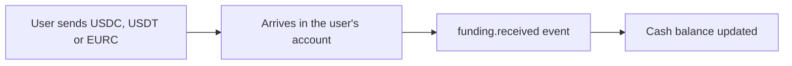

Every user has a cash balance. Buys spend it, sells add to it, and it shows in the portfolio as the `usd` position.

## Funding currencies

Accounts are funded with digital dollars and euros:

| Asset | Currency |
| --- | --- |
| `usdc` | US dollar |
| `usdt` | US dollar |
| `eurc` | Euro |

Bank transfers and local currencies aren't supported yet. If your users hold local currency, convert to one of the assets above before funding.

## One balance per currency

A user has one dollar balance, whatever mix of `usdc` and `usdt` they deposited and wherever those deposits arrived. When they buy something, we convert and move the money as needed. You never have to check that the cash is "in the right place" before a trade.

## Deposits

Each user has their own deposit addresses. Ask for them with [deposit instructions](/api-reference/funding/deposit-instructions), show them to the user, and they send funds from wherever they hold them.

When a deposit lands you receive a `funding.received` [event](/guides/events) and the user's cash balance goes up. Deposits are detected automatically. There's nothing to confirm.

<Note>
  A deposit address is tied to a network, the same way a bank account is tied to a payment system. Show the user the address for the network they're sending from. Deposit instructions return one address per supported network.
</Note>

## Withdrawals

A [withdrawal](/api-reference/funding/withdraw) sends cash from the user's account to an address they choose. You name the asset, the amount, the network and the destination. Destinations are screened before any money moves.

A withdrawal starts as `pending` and becomes `completed` once it's confirmed. If it can't be sent, it becomes `failed` and the money returns to the user's balance.

## Linked wallets

If your app already gives each user a wallet, you can [link it](/api-reference/users/link-wallet) to their account. Then:

- **Buys can be funded from it.** An order for a user without enough cash waits in `awaiting_funding` and tells you exactly what to send. It continues by itself when the transfer arrives.
- **Sells can pay back into it.** Proceeds return to the linked wallet automatically, so the user's money ends up where they keep it.

See [Fund accounts](/guides/fund-accounts) for both flows.

## In the sandbox

Sandbox money is simulated. Credit a user instantly with [`POST /v1/sandbox/funding/credit`](/api-reference/sandbox/credit).
