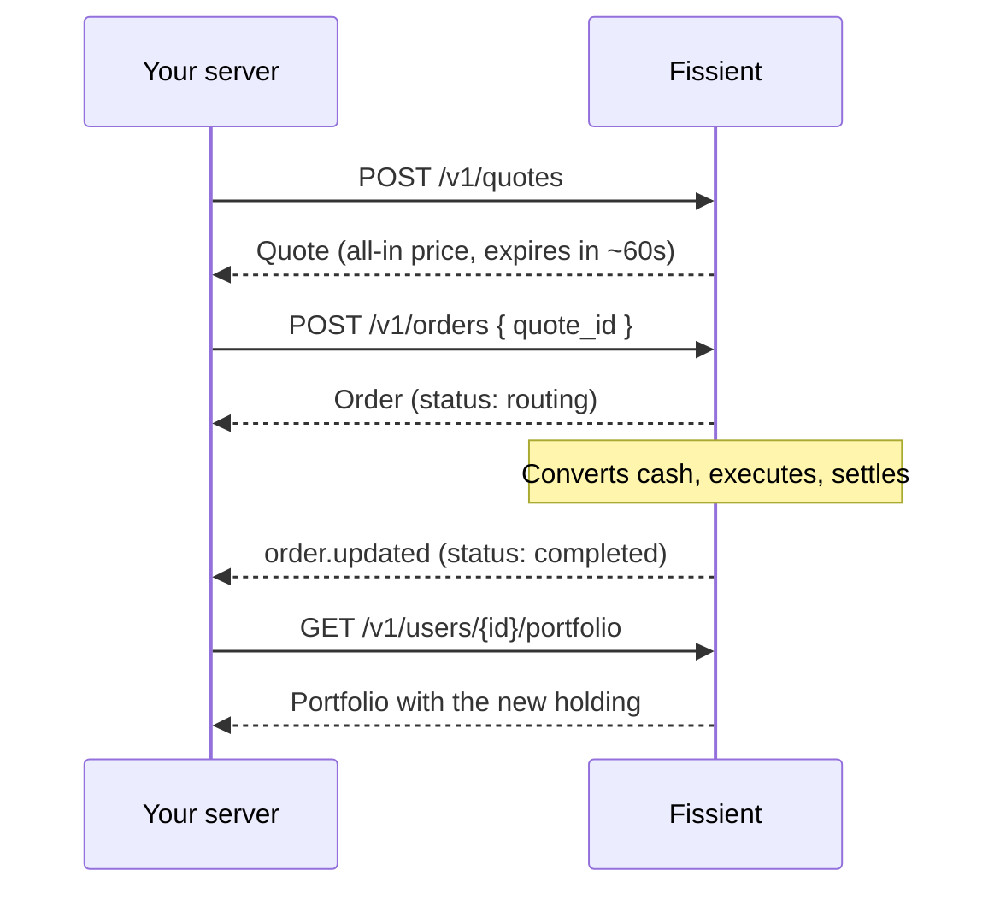

Fissient exposes financial concepts and nothing below them. If you've used a brokerage or payments API, the model will feel familiar.

## The five objects

<CardGroup cols={2}>
  <Card title="User" icon="user" href="/concepts/users">
    One of your customers, and the account we open for them.
  </Card>
  <Card title="Instrument" icon="building-columns" href="/concepts/instruments">
    Something a user can hold: NVIDIA, Gold, Dollar Savings, Bitcoin.
  </Card>
  <Card title="Quote" icon="receipt" href="/concepts/quotes-and-orders">
    A firm, all-in price for one trade, valid for about a minute.
  </Card>
  <Card title="Order" icon="arrow-right-arrow-left" href="/concepts/quotes-and-orders">
    A trade in progress or finished.
  </Card>
  <Card title="Portfolio" icon="chart-pie" href="/concepts/portfolio">
    Everything a user holds and what it's worth.
  </Card>
</CardGroup>

## The life of a trade

1. **You ask for a quote.** We check that the user is allowed to make the trade, find the best price, and return what they'll pay, what they'll get, and one fee.
2. **You place the order.** The user confirms in your app, and you send us the quote's id.
3. **We execute it.** The order moves through `routing` and `settling` to `completed`. Most orders finish in seconds.
4. **You hear about it.** You can hold the request open with `?wait=30`, receive a [webhook](/guides/events), or poll the order.
5. **The portfolio updates.** The holding appears with its cost basis, and profit and loss start tracking.

## One asset, one instrument

A user buys *NVIDIA*, *Gold* or *Dollar Savings*. They don't choose between different versions of the same thing.

Behind each instrument there can be several ways to fulfil an order. For every order we pick the one with the best net price, or the best net rate for savings. That choice never changes what the user is promised: the quote they accept is the outcome they get.

## Money in, money out

Each user has one cash balance per currency. They fund it with digital dollars or euros (USDC, USDT or EURC), buys spend from it, and sells pay back into it. Getting the money to wherever a trade needs it is our job. See [Cash and funding](/concepts/cash-and-funding).

## Rules are enforced for you

Two layers of rules run on every quote and order, on our servers:

- **[Eligibility](/concepts/eligibility)** decides what a user may buy, based on where they live and the rules of each instrument.
- **[Guardrails](/concepts/guardrails)** are limits you or the user set: a maximum order size, an approval threshold, a cap on leverage.

A refused request always returns an error with a stable `code`, so your app and any AI agent can explain exactly what happened.

## Two ways in

| Interface | Built for | Authentication |
| --- | --- | --- |
| REST API | Your backend | Secret key (`sk_`) |
| MCP server | AI agents acting for a user | Agent key (`ak_`) |

Both run on the same engine with the same rules. An agent can't do anything through MCP that the user's guardrails don't allow. See [AI agents](/agents/overview).
